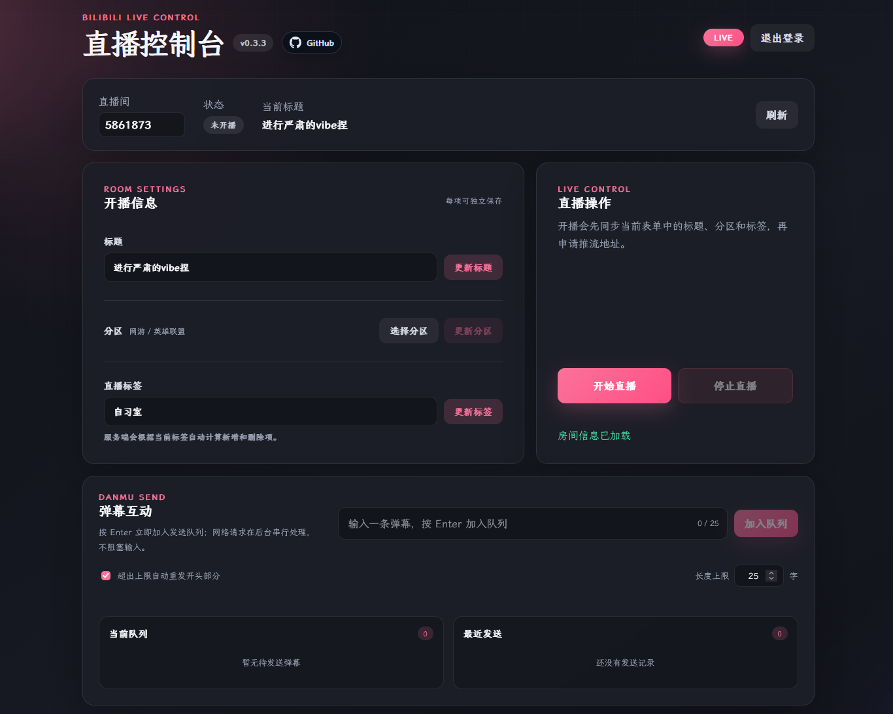
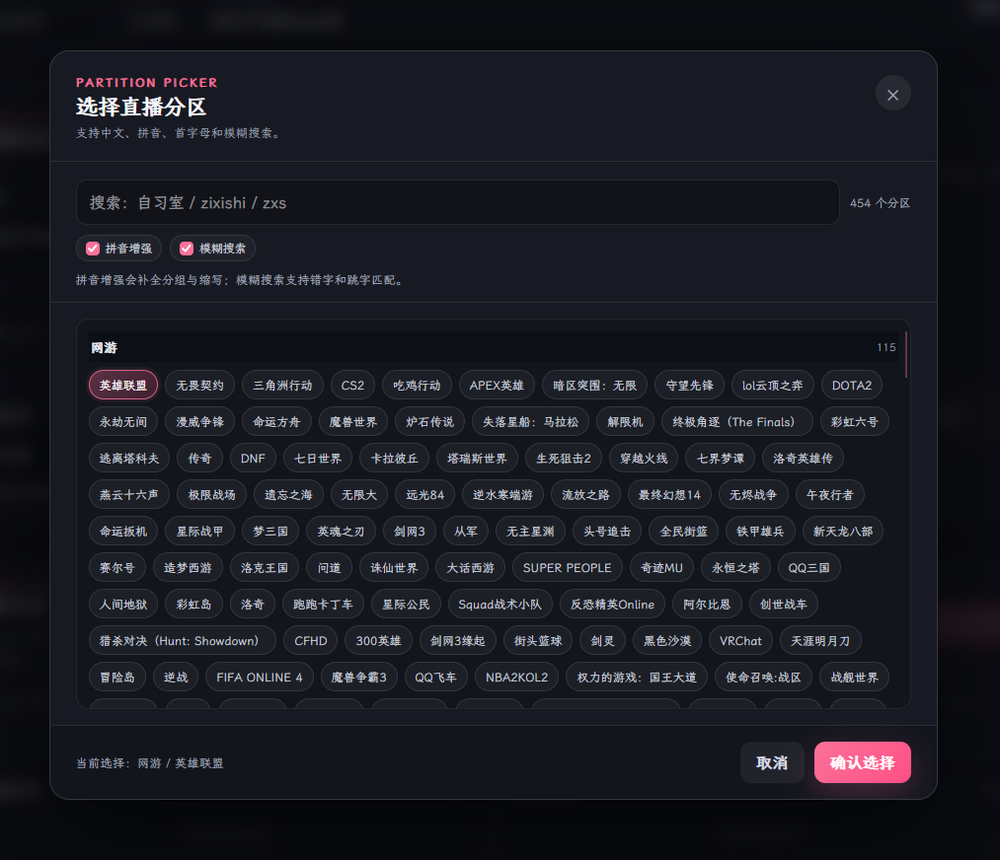

# 🎥 Bili Live API Bridge

<p align="center">
  <a href="https://live.bilibili.com/5861873" target="_blank" rel="noopener noreferrer"></a>
  <a href="https://nodejs.org/" target="_blank" rel="noopener noreferrer"></a>
  <a href="https://github.com/VincentZyuLive" target="_blank" rel="noopener noreferrer"></a>
</p>

一个非官方的 B 站直播 API 桥接工具。它通过本地 WebUI 完成扫码登录、直播间信息维护、开播与关播，并为 OBS Studio 等通用推流软件提供 RTMP 推流信息。

一个典型场景是 Linux 直播：B 站官方直播姬目前仅提供 Windows 和 macOS 客户端，但 Linux 用户同样希望通过 OBS 完成开播（比如我 VincentZyu）。本项目把扫码登录、直播间状态管理和推流信息获取放到本地 WebUI 中，不依赖官方直播姬客户端。

> [!TIP]
> 这是 VincentZyu 的自用直播工具，主要服务于个人直播工作流实验。项目会按实际使用需求持续迭代，也欢迎体验、提交 Issue 或 PR。
>
> 组织主页：[VincentZyuLive](https://github.com/VincentZyuLive)

> [!IMPORTANT]
> 本项目不是 B 站官方项目，也不是完整的直播姬替代品。B 站接口、风控和参数可能随时变化。
>
> 本项目不提供绕过实名认证、人脸认证、风控验证或其他身份校验的能力。扫脸必须由账号本人通过 B 站官方流程完成。

## 🖼️ WebUI 预览

**首页**



**分区选择弹窗**



## ✨ 核心能力

### 🎛️ 直播控制

- 使用 B 站手机客户端扫码登录。
- 查看直播间号、标题、分区、标签和直播状态。
- 分别修改标题、分区和标签，也可以随开播请求同步表单信息。
- 开始直播并获取 RTMP 服务器和推流密钥。
- 在 WebUI 中随时停止直播。
- 分区选择器支持中文、全拼、首字母和模糊搜索。

### 💬 弹幕互动

- 使用当前登录的主播账号，在自己的直播间发送普通弹幕。
- 按 Enter 将弹幕加入后台发送队列，不阻塞输入和其他页面操作。
- 展示当前队列和最近 8 条发送状态。
- 默认按 25 字配置长度上限，并允许自定义。
- B 站返回超长错误时，可自动重发消息开头部分。
- 区分成功、失败、超频和疑似屏蔽词等返回状态。

### 🎨 界面与安全

- 内置霞鹜文楷 LXGW WenKai 字体，不依赖外部字体 CDN。
- 登录凭据保存在服务端会话中，不写入浏览器 `localStorage`、URL 或页面日志。
- 遇到需要人脸认证的开播错误时，展示 B 站官方认证二维码。

当前不包含直播画面预览、弹幕接收/展示、礼物统计和录制。OBS 场景、舞台和素材由独立项目负责；本工具仅管理直播间状态并提供 RTMP 推流信息。

## 🚀 快速开始

需要 Node.js 20 或更高版本。首次运行先安装依赖：

```bash
npm ci
```

启动真实模式：

```bash
npm start -- --live
```

服务默认监听并自动打开：

```text
http://127.0.0.1:61611
```

不传模式参数时默认使用 `--live`。如果只想预览 UI 或进行本地测试，可以使用不会访问 B 站的 Mock 模式：

```bash
npm start -- --mock
```

### 🖥️ 启动脚本

Windows 双击 `scripts/start-bili-bridge.cmd`，Linux/macOS 使用：

```bash
./scripts/start-bili-bridge.sh
```

脚本会先检查服务是否已经运行；已运行时只打开 WebUI，未运行时通过 `npm start` 启动。首次运行若缺少 `node_modules` 会自动执行 `npm ci`。启动参数会原样传透：

```powershell
.\scripts\start-bili-bridge.cmd --mock --port 62000
```

```bash
./scripts/start-bili-bridge.sh --live --port 62000
```

Windows 桌面快捷方式可运行 `scripts\create-desktop-shortcut.cmd` 生成，名称为 `Bili Live Bridge`；图标由网站 favicon 与 VincentZyu233 的 GitHub 头像组合而成。关闭终端或控制台窗口即可停止服务。

## 🧭 使用流程

1. 启动服务并打开 WebUI。
2. 点击“获取登录二维码”，使用哔哩哔哩手机客户端扫码。
3. 登录成功后，页面会自动读取当前直播间信息。
4. 修改标题、分区或标签，也可以直接点击“开始直播”。
5. 开播成功后，将 WebUI 中的 RTMP 服务器和推流密钥填入 OBS。
6. 结束直播时，在 WebUI 点击“停止直播”。

<details>
<summary><strong>⚙️ 启动参数与环境变量</strong></summary>

### 命令行参数

| 参数 | 说明 |
| --- | --- |
| `--live` | 使用真实 B 站接口，也是默认模式 |
| `--mock` | 使用本地 Mock 数据，不访问 B 站 |
| `--port 61611` | 修改监听端口，也支持 `--port=61611` |
| `--host 127.0.0.1` | 修改监听地址，也支持 `--host=0.0.0.0` |
| `--no-open` | 启动后不自动打开浏览器 |

### 环境变量

| 变量 | 默认值 | 说明 |
| --- | --- | --- |
| `BILI_BRIDGE_MODE` | `live` | 设置为 `mock` 时使用 Mock 模式 |
| `HOST` | `127.0.0.1` | WebUI 与 API 监听地址 |
| `PORT` | `61611` | WebUI 与 API 监听端口 |
| `BILI_BRIDGE_NO_OPEN` | 未设置 | 设置为 `1` 时禁止自动打开浏览器 |
| `BILI_PROXY_URL` | 未设置 | 仅用于服务端访问 B 站时使用的 HTTP/HTTPS 代理 |

Windows PowerShell 代理示例：

```powershell
$env:BILI_PROXY_URL = "http://127.0.0.1:7890"
npm start -- --live
```

Linux/macOS 代理示例：

```bash
BILI_PROXY_URL=http://127.0.0.1:7890 npm start -- --live
```

自定义监听地址：

```bash
npm start -- --live --port 62000 --host 0.0.0.0
```

WebUI 和 API 默认只监听本机。不建议将服务暴露到公网；若必须跨机器访问，应放在受信任的内网中，并通过防火墙限制来源地址。

</details>

<details>
<summary><strong>🔐 登录会话说明</strong></summary>

扫码登录成功后，服务端会：

- 创建登录会话，并通过 `HttpOnly`、`SameSite=Strict` Cookie 关联浏览器。
- 将未过期会话持久化到 `cache/cookie/sessions.json`。
- 服务重启后从该文件恢复登录态，浏览器无需重新扫码。
- 会话空闲 7 天后失效，绝对最长有效期为 30 天；正常使用会持续续期。
- 浏览器会话 Cookie 最长保留 30 天；超过 7 天未使用、达到 30 天、换浏览器或清除浏览器 Cookie 后仍需重新扫码。

WebUI 不会把 `SESSDATA`、`bili_jct` 写入 `localStorage`、URL 或页面日志。

</details>

<details>
<summary><strong>🌐 HTTP API 完整参考</strong></summary>

WebUI 使用登录 Cookie 调用接口，因此页面请求不需要重复携带凭据。旧客户端仍可在请求体中传入以下字段：

```json
{
  "SESSDATA": "<SESSDATA>",
  "bili_jct": "<BILI_JCT>",
  "DedeUserID": "<DEDE_USER_ID>",
  "buvid3": "<BUVID3>"
}
```

> [!CAUTION]
> 不要在 Issue、截图、日志或公开仓库中提交真实 Cookie、`SESSDATA`、`bili_jct` 或认证链接。

### 接口列表

| 方法 | 路径 | 用途 |
| --- | --- | --- |
| `GET` | `/api/health` | 获取运行模式和状态 |
| `GET` | `/api/login/qrcode` | 获取登录二维码和临时会话 Token |
| `GET` | `/api/login/poll?token=...` | 轮询扫码状态并建立登录会话 |
| `GET` | `/api/auth/session` | 查询当前 WebUI 登录状态，不返回凭据 |
| `POST` | `/api/auth/logout` | 退出当前 WebUI 会话 |
| `POST` | `/api/partitions` | 获取直播分区列表 |
| `POST` | `/api/room/info` | 获取当前直播间信息 |
| `POST` | `/api/room/update` | 更新标题、分区或标签 |
| `POST` | `/api/start-stream` | 同步开播信息并申请推流 |
| `POST` | `/api/stop-stream` | 关闭直播 |
| `POST` | `/api/danmaku/send` | 向当前直播间发送普通弹幕 |

### ✏️ 更新直播间信息

`POST /api/room/update` 支持按需提交以下字段：

```json
{
  "roomId": "123456",
  "title": "新的直播标题",
  "partitionId": 236,
  "tags": ["音乐", "聊天"]
}
```

- `roomId` 可省略，服务端会通过当前登录用户的 UID 获取直播间号。
- 标签会与当前标签比较，自动转换为 B 站接口需要的 `add_tag` 和 `del_tag`。
- 分区 ID 必须存在于当前直播分区列表。
- 只提交需要修改的字段。

### ▶️ 开播

`POST /api/start-stream` 支持提交当前表单中的标题、分区和标签。服务端会先更新有变化的直播信息，再申请开播：

```json
{
  "partitionId": 236,
  "title": "直播标题",
  "tags": ["音乐", "聊天"]
}
```

成功响应包含：

```json
{
  "code": 0,
  "message": "Live stream started successfully",
  "serverUrl": "rtmp://...",
  "streamKey": "..."
}
```

### ⏹️ 关播

```json
POST /api/stop-stream
{}
```

### 💬 发送弹幕

`POST /api/danmaku/send` 使用当前登录账号向自己的直播间发送普通弹幕：

```json
{
  "message": "WebUI 弹幕测试"
}
```

- `roomId` 可省略，默认使用当前登录账号自己的直播间。
- 服务端最多接受 1000 个 Unicode 字符，不允许换行或控制字符。
- 使用普通白色滚动弹幕参数：`fontsize=25`、`color=16777215`、`mode=1`。
- WebUI 默认按 25 字配置上限，但首次仍发送完整消息。
- 开启“超出上限自动重发开头部分”后，若 B 站返回 `1003212`，只重发开头 `limit` 个字符一次。
- B 站返回 `10031` 时表示发送频率过快。
- 返回 `code: 0` 且 `msg` 为 `ok`、`success` 或空值时视为成功；`msg: "f"` 等明确拒绝信息显示为疑似屏蔽词。

### 📤 WebUI 弹幕队列

- 按 Enter 时同步入队、清空输入框并刷新列表，然后由后台 worker 串行发送。
- 等待中的消息会显示“排队中”，请求期间显示“发送中”。
- 单条请求失败不会阻塞后续消息。
- 最近记录保留成功、失败、超限开头重发和疑似屏蔽词状态。
- 队列不会写入本地存储，刷新页面后不会自动重发旧消息。
- 长度上限、目标直播间和自动重发开关保存在浏览器 `localStorage` 中。
- 目标直播间可手动填写；自动解析不到主播房间时，填写直播间号即可继续发送。

</details>

## 🪪 人脸认证与错误码

直播姬日志和实际开播流程中可能遇到：

```text
code: 60043
message: 本次开播需要身份验证，请在关播时点击开播唤起人脸认证
```

也可能是 `60024`。此时应：

1. 由账号本人通过 B 站官方页面或官方客户端完成认证。
2. 不要把 `SESSDATA`、`v_voucher` 或认证链接交给第三方。
3. 不要尝试伪造摄像头、替代认证主体或绕过风控。
4. 认证完成后重新登录或重新发起开播请求。

## 🛰️ 网络与排障

- 浏览器显示 `NetworkError` 且无法访问 `61611` 时，通常是本地服务没有启动。
- 本地服务正常但访问 B 站失败时，`/api/login/qrcode` 会返回 HTTP `502` 和 `stage: "bilibili_network"`。
- 可通过 `BILI_PROXY_URL` 为服务端 B 站请求配置 HTTP/HTTPS 代理。
- `/api/health` 的 `upstreamProxy` 字段会显示当前是 `direct` 还是 `configured`。
- 开播成功仅代表 B 站已返回推流信息，仍需检查 OBS 是否正常推流以及直播间是否收到画面。

## ⚠️ 已知限制

- 接口参数、请求头和风控规则可能随时发生变化。
- 本项目不是完整直播姬替代品，不提供实名认证、人脸认证或风控绕过能力。
- 登录会话空闲 7 天后失效，绝对最长有效期为 30 天；失效后需要重新扫码。
- Cookie 与会话文件以明文 JSON 保存，文件权限由程序设置为 `0600`，仅适合个人受控环境。
- 不包含直播画面预览、弹幕接收/展示、礼物统计和录制。

## 🔒 安全建议

- 默认只监听 `127.0.0.1`，不要直接把 WebUI 暴露到公网。
- 不要把 `cache/cookie/`、`.env`、请求体截图或完整日志上传到 GitHub。
- 不要把真实 `SESSDATA`、`bili_jct` 或认证链接交给第三方。
- 怀疑凭据泄露时，立即退出 B 站相关设备的登录并重新扫码。

<details>
<summary><strong>🧪 开发与测试</strong></summary>

```bash
npm run typecheck
npm test
npm start -- --mock
```

自动化测试覆盖：

- 默认端口与 Mock/真实模式参数。
- 扫码会话和 HttpOnly Cookie。
- 旧版请求体凭据兼容。
- 标题、分区、标签修改。
- 分区 ID 校验和分区搜索。
- 开播、下播和推流信息。
- 人脸认证错误透传。
- 弹幕队列与发送状态处理。

真实开播测试会实际改变直播间状态。测试前应保存原房间标题、分区和标签，测试结束后恢复；若触发人脸认证，应立即停止测试并通过官方流程处理。

</details>

## 📄 免责声明

本项目仅用于学习、研究和个人直播工作流互操作性测试。使用本项目造成的账号风险、风控限制、直播中断或数据泄露，由使用者自行承担。请遵守 B 站用户协议和相关法律法规。
